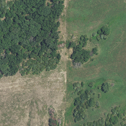
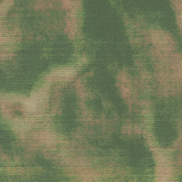
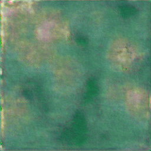
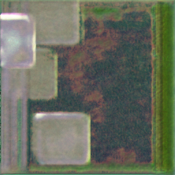
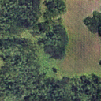
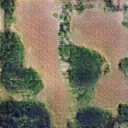
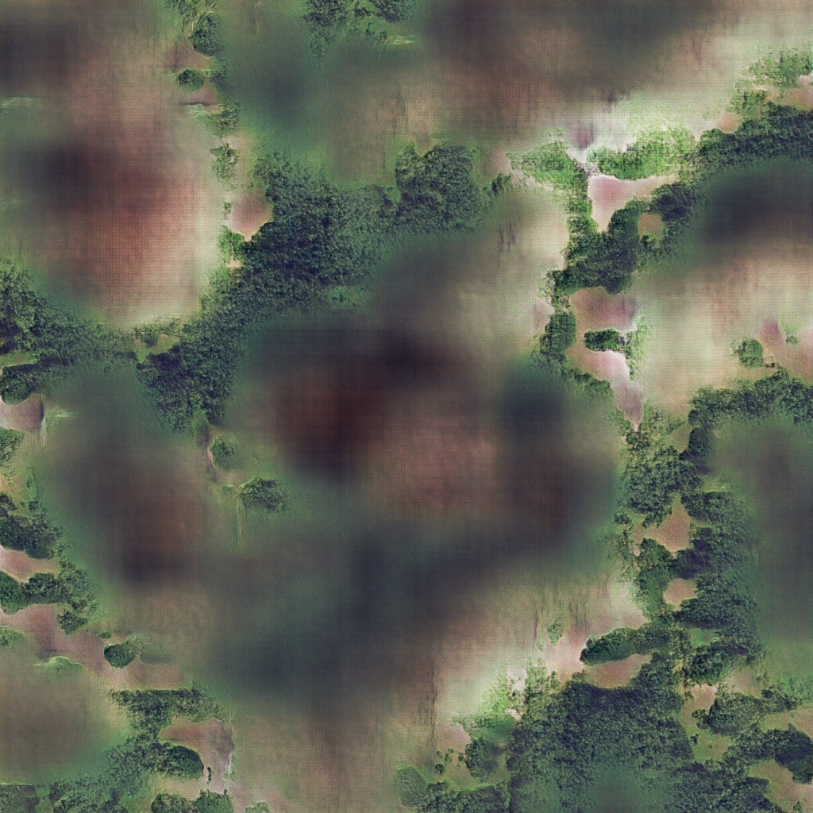

# aerial_imagery_gan

Generative models for aerial imagery: a label-conditional **GAN** (SPADE-style) and a
small **diffusion** model (rectified flow), trained on 4-band
[NAIP](https://www.fsa.usda.gov/programs-and-services/aerial-photography/imagery-programs/naip-imagery/)
scenes (R, G, B, NIR).

Both models can optionally be conditioned on per-pixel label maps (CDL land cover
classes, roads, buildings). With labels you get "paint a map, get an aerial photo":
give the model the label map of any area and it produces a matching image, at sizes
much larger than the patches it was trained on.

## Setup

Install [uv](https://docs.astral.sh/uv/), then:

```bash
uv sync                    # creates .venv and uv.lock
uv sync --extra metrics    # optional: also installs the KID metric (torchmetrics)
```

On Linux, PyTorch comes from the CUDA 11.8 wheel index (see `[tool.uv.sources]`
in `pyproject.toml`). CUDA 11.8 is the newest CUDA that runs on NVIDIA driver 470,
and those wheels still support Pascal GPUs like the Quadro P2000. If you upgrade
the driver to 535 or later, you can switch the index to `cu126`.

Check that the GPU is visible:

```bash
uv run python -c "import torch; print(torch.__version__, torch.cuda.is_available(), torch.cuda.get_device_name(0))"
```

## Data layout

```
naip/                    m_4209141_sw_15_1_20170908.tif, ...   (4 bands, uint8)
cdl_annotations/         same filenames: Cropland Data Layer codes        (optional)
road_annotations/        same filenames: 1 = road                         (optional)
building_annotations/    same filenames: 1 = building                     (optional)
```

Label rasters must have the same width and height as their NAIP scene. The label
classes, their codes, and their priority (which class wins when a road crosses a
forest pixel, for example) are defined in `src/aerial_imagery_gan/config.py`. With
`--labels auto` (the default), the models condition on labels only if every scene
has all three label rasters. `naip_scenes.txt` lists the scenes used in earlier
experiments.

All scenes are loaded into RAM as uint8: about 250 MB per scene, including labels.

## Training

```bash
uv run aerial train --model gan
uv run aerial train --model diffusion
uv run aerial train --help          # every hyperparameter is a flag
```

The defaults (128×128 patches, batch size 8, float32) are sized for a 4 GB Pascal
GPU. Mixed precision and `torch.compile` are left out on purpose: Pascal GPUs have
no tensor cores, and Triton (which `torch.compile` uses) needs a newer GPU.

Each run writes to `runs/<model>_<timestamp>/`:

* `samples/0001000.png` and so on: the same fixed real patches every time. Rows,
  from top to bottom:
  1. the label map (if labels are used)
  2. the real RGB image
  3. two generated RGB images, from two noise seeds
  4. the real image as NIR-R-G false color (vegetation shows up red)
  5. a generated image as NIR-R-G false color

  With labels, generated and real images in the same column share a label map.
* `losses.csv` and `losses.png`
* `checkpoints/last.pt` (full state, for resuming) and `checkpoints/ema_*.pt`
  (generator weights only, for sampling)

Resume an interrupted run (flags you pass override the stored config):

```bash
uv run aerial train --resume runs/gan_20261105_120000/checkpoints/last.pt --steps 300000
```

If you run out of GPU memory, lower `--batch-size`, `--gan-channels` /
`--unet-channels`, or `--patch-size`.

### What to expect

* **GAN:** sharp images early, but training is an adversarial game. Watch the
  sample grids, not the losses. `d_real` should stay above `d_fake`. If
  `d_real` - `d_fake` grows very large and the samples stop improving or
  degrade, the discriminator is winning: lower `--lr-discriminator`.
* **Diffusion:** the loss is an honest MSE and decreases slowly. Samples start
  blurry or noisy and sharpen over tens of thousands of steps. It is slower per
  step and much slower to sample (`--sample-steps` network evaluations per image,
  twice that with guidance). It is usually more reliable than a GAN in the end.

Training is slow on a laptop GPU. Plan for overnight runs, and check the it/s in
the progress bar to estimate how long a run will take.

## Generating images

```bash
# Grid of generated vs real patches
uv run aerial sample --checkpoint runs/<run>/checkpoints/last.pt --n 8

# A large image from the label map of a 1024x1024 window of a real scene
uv run aerial large --checkpoint runs/<run>/checkpoints/last.pt \
    --scene naip/m_4209141_sw_15_1_20170908.tif --row 2000 --col 2000 --size 1024 --n 3

# Kernel Inception Distance on RGB patches (lower is better).
# Compare checkpoints with the same --n and --seed.
uv run aerial kid --checkpoint runs/<run>/checkpoints/last.pt --n 1000
```

For the diffusion model, `--guidance-scale` (default 2) trades diversity for
adherence to the labels, and `--sample-steps` (default 50) trades speed for quality.

## Tests

```bash
uv run pytest
```

These are fast CPU smoke tests on small synthetic GeoTIFFs, so they need no real data.

## History

The first version (2020, TensorFlow 2.3) used an unconditional U-Net generator fed
with full-resolution noise and a DCGAN-style discriminator. The images were never
convincing. Real NAIP patches:




Generated images (unconditional), which looked vaguely like forest or pasture at best:




A later experiment (PR #1) conditioned the generator on CDL, road and building
labels, which helped a lot at the 128×128 training size:




But large images generated by the fully convolutional generator broke down into blobs:



The current version is a rewrite in PyTorch. Its GAN keeps the label conditioning
but uses a SPADE generator, a multi-scale PatchGAN discriminator with spectral norm,
hinge plus feature-matching losses, and an EMA of the generator. It also adds a
diffusion model as a second approach.
